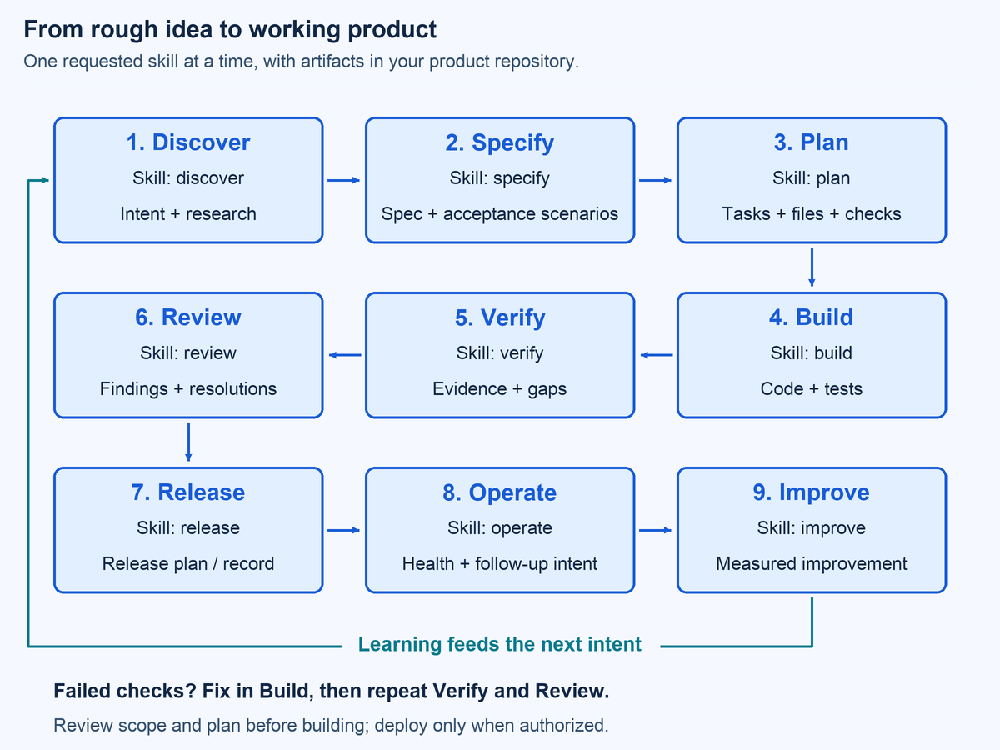
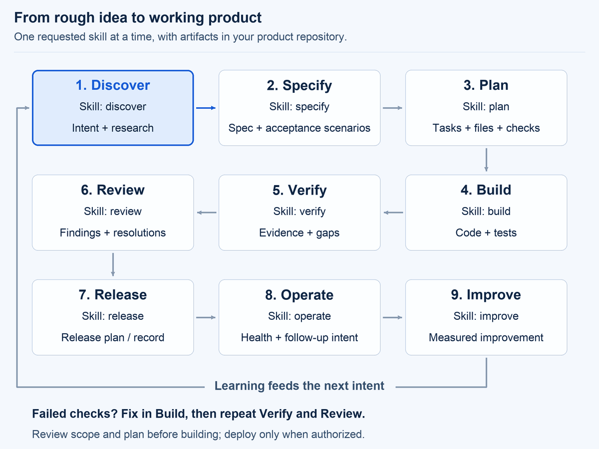

# AI-SDLC skill pack

[Repository](https://github.com/jig21nesh/ai-sdlc) · Maintained by [Jignesh Kakkad](https://github.com/jig21nesh)

Turn a rough idea into a researched intent, a working product and a repeatable delivery process. This package contains **20 skills** grounded in [Anthropic's AI-native SDLC playbook](https://claude.com/resources/articles/the-ai-native-sdlc-playbook), with reusable templates and supporting research.

**Install the package once in Codex or Claude Code; use it from each product's folder.** Both hosts use the same twenty skills and templates. You provide the idea, review the evidence and decide what to build.

1. **One-time setup:** [install the plugin for your host](#install-once-for-your-host) from this package's checkout.
2. **For each product:** open its repository or an empty product folder in Codex or Claude Code and start a new chat.
3. **Give it your idea:** paste the [discovery prompt below](#start-with-a-rough-product-idea).
4. **Continue when ready:** use the [step-by-step guide](#step-by-step-guide) and [next-step prompts](#continue-after-discovery).

## Start with a rough product idea

Open the **product's folder** in your host and invoke the installed discovery skill.

**Codex:**

```text
Use $ai-sdlc:ai-sdlc-discover.

My idea: <describe the product or problem in your own words>.

Explore the idea, research relevant competitors, alternatives and feasibility,
and draft the intent in this project. Ask focused questions where needed.
```

**Claude Code:**

```text
/ai-sdlc:ai-sdlc-discover

My idea: <describe the product or problem in your own words>.

Explore the idea, research relevant competitors, alternatives and feasibility,
and draft the intent in this project. Ask focused questions where needed.
```

A short description is enough—for example, “Help small Australian trades businesses turn voice notes into quotes.” Add an audience, region, budget or deadline if you have one. Discovery selects research that helps the product decision, cites available sources and separates evidence from assumptions. Browsing depends on the host's tools and permissions; unavailable research is reported as a gap.

**What you get:** an intent brief covering the problem, intended users, proposed outcome, scope, success measures and open questions. Outputs follow the product's existing convention; the defaults are:

- `docs/intent.md` — the product intent to review.
- `docs/research.md` — supporting sources and findings when research is substantial.
- `docs/intents/<idea-name>/` — a separate location when the default intent already belongs to another idea.

These files belong in **your product repository**. The central package holds reusable skills. Discovery finishes with a draft and the next decision; you choose when to move into specification and implementation.

## See the flow



[Open the full-size static diagram](assets/product-flow.png), or expand the animation below. The table is the text equivalent.

<details>
<summary>Play the animated product flow (GIF)</summary>



</details>

This is our practical usage sequence, mapped to the playbook's six lifecycle phases. **Run the relevant skills as needed:** the diagram is a guide, and invoking one skill does not automatically run the whole sequence. An existing product or a small fix can start at the step that matches the work.

## Step-by-step guide

**Agent** below means the role your coding assistant takes while using that skill. The role labels describe the work; they do not create separate agents. Click a skill to read its instructions. Invoke `discover` with **`$ai-sdlc:ai-sdlc-discover`** in Codex or **`/ai-sdlc:ai-sdlc-discover`** in Claude Code. Use a separate reviewer when independent review is required.

**Source** identifies the supporting article and its stage/topic. The nine steps and their skill procedures are this toolkit's adaptation; additions are marked below. See the [detailed practice mapping](research/practice-coverage.md) for full traceability.

| Step | One-line explainer | Agent / skill | Input | Output | How to validate | What to watch for | Source |
| --- | --- | --- | --- | --- | --- | --- | --- |
| **1. Discover** | Research the idea and decide what problem to solve. | Researcher<br>[discover](skills/ai-sdlc-discover/SKILL.md) | Your idea and constraints | Intent brief; research if useful | Check sources, target users and success measures. | Assumptions presented as facts; scope too broad. | [Anthropic playbook](https://claude.com/resources/articles/the-ai-native-sdlc-playbook), Stage 1: intent capture.<br>Competitor research is a [toolkit addition](skills/ai-sdlc-discover/SKILL.md#research-as-part-of-discovery). |
| **2. Specify** | Define what the product must do and how it should behave. | Specification author<br>[specify](skills/ai-sdlc-specify/SKILL.md) | Intent and existing behavior | Requirements/design spec with acceptance scenarios | Can you test each outcome, including failures? | Vague requirements; missing error paths. | [Anthropic playbook](https://claude.com/resources/articles/the-ai-native-sdlc-playbook), Stage 2: combined requirements and design. |
| **3. Plan** | Turn the accepted specification into bounded implementation tasks. | Planner<br>[plan](skills/ai-sdlc-plan/SKILL.md) | Accepted spec and repository context | Plan with files, dependencies and checks | Every requirement maps to a task and proof. | Invented paths; overlooked dependencies. | [Anthropic playbook](https://claude.com/resources/articles/the-ai-native-sdlc-playbook), Stage 3: implementation planning in Build. |
| **4. Build** | Implement the agreed change and check it as you go. | Implementer<br>[build](skills/ai-sdlc-build/SKILL.md) | Accepted plan and current code | Reviewable code, tests and check results | Inspect the diff; run the relevant checks. | Unrelated edits; weakened tests. | [Anthropic playbook](https://claude.com/resources/articles/the-ai-native-sdlc-playbook), Stages 3–4: implementation with continuous checks. |
| **5. Verify** | Check the actual candidate against the acceptance scenarios. | Verifier<br>[verify](skills/ai-sdlc-verify/SKILL.md) | Candidate, spec and test environment | Verification report with evidence and gaps | Reproduce happy paths and important failures. | Stale results; untested integrations. | [Anthropic playbook](https://claude.com/resources/articles/the-ai-native-sdlc-playbook), Stage 4: test feedback.<br>Separate candidate verification is our adaptation. |
| **6. Review** | Assess the change and resolve findings before release. | Reviewer<br>[review](skills/ai-sdlc-review/SKILL.md) | Diff, requirements and verification evidence | Findings, dispositions and recheck evidence | Material findings have a recorded resolution. | Open risks; self-review called independent. | [Anthropic playbook](https://claude.com/resources/articles/the-ai-native-sdlc-playbook), Stage 5: reviewing PRs and addressing findings. |
| **7. Release** | Prepare delivery and deploy when authorized. | Release operator<br>[release](skills/ai-sdlc-release/SKILL.md) | Reviewed candidate, target and release authority | Release plan/record; deployment if authorized | Match the checked artifact; verify health and recovery. | Wrong environment; unsafe migrations. | [Anthropic playbook](https://claude.com/resources/articles/the-ai-native-sdlc-playbook), Stage 5: approval controls and CI/CD delivery. |
| **8. Operate** | Use real service signals to investigate health and incidents. | Operator<br>[operate](skills/ai-sdlc-operate/SKILL.md) | Telemetry, feedback and runbooks | Health/incident evidence and follow-up intent | Check fresh signals and confirm recovery. | Stale alerts; unverified fixes. | [Anthropic playbook](https://claude.com/resources/articles/the-ai-native-sdlc-playbook), Stage 6: production signals become follow-up intent. |
| **9. Improve** | Turn measured lessons into a specific workflow improvement. | Improvement analyst<br>[improve](skills/ai-sdlc-improve/SKILL.md) | Outcomes, incidents and repeated mistakes | Scoped improvement with comparison evidence | Compare with the baseline; check regressions. | Extra rules without evidence of benefit. | Toolkit synthesis: [playbook](https://claude.com/resources/articles/the-ai-native-sdlc-playbook) Stages 4–6, regression and feedback practices; [Google SRE](https://sre.google/sre-book/postmortem-culture/), learning from postmortems. |

**When a check fails:** fix the relevant build issue and rerun affected verification and review on the changed candidate. If the problem is the requirement itself, return to Specify. Use operations and improvement findings as input to the next intent.

You decide which intent, specification and plan to accept. Existing authorization carries forward within its scope; release actions also need the actual target, artifact and applicable authority. Routine work does not require filling out every organization profile.

## Continue after discovery

Send **one prompt at a time** in the same product chat, after reviewing the previous output. Replace the example paths if your project uses different ones. For later artifacts, follow the project's existing documentation conventions.

The examples below use Codex syntax. In Claude Code, replace `Use $ai-sdlc:ai-sdlc-<step>` with `/ai-sdlc:ai-sdlc-<step>` and keep the task text. For example:

```text
/ai-sdlc:ai-sdlc-specify Turn docs/intent.md into a requirements and design specification with testable acceptance scenarios.
```

```text
Use $ai-sdlc:ai-sdlc-specify to turn docs/intent.md into a requirements
and design specification with testable acceptance scenarios.
```

Once the specification matches what you want:

```text
Use $ai-sdlc:ai-sdlc-plan to plan implementation of the accepted specification.
Identify the files, dependencies, task order and checks.
```

Once you accept the plan:

```text
Use $ai-sdlc:ai-sdlc-build to implement the first agreed slice of the plan.
Run the relevant checks and show the diff, results and remaining gaps.
```

For a reviewable candidate:

```text
Use $ai-sdlc:ai-sdlc-verify to check this candidate against the acceptance scenarios.
```

```text
Use $ai-sdlc:ai-sdlc-review to review the current diff, specification and
verification evidence. Report findings and any remaining decisions.
```

For release preparation:

```text
Use $ai-sdlc:ai-sdlc-release to prepare the release plan for this reviewed
candidate. Identify the target, rollout, health checks and recovery steps.
```

After release, when you have service signals or delivery results:

```text
Use $ai-sdlc:ai-sdlc-operate to assess <service/environment> using available
telemetry, feedback and runbooks. Record health, evidence gaps and follow-up work.
```

```text
Use $ai-sdlc:ai-sdlc-improve to review this delivery's results and repeated
problems. Propose one evidence-backed improvement and how to measure it.
```

If you start a new chat, include the relevant artifact paths, candidate revision and previously accepted decisions so the next skill can resume accurately.

## Install once for your host

Get the package from the personal repository:

```sh
git clone https://github.com/jig21nesh/ai-sdlc.git
cd ai-sdlc
```

Choose either host, or install in both. Each installation is user-scoped and available from your product folders. Keep this checkout as the update source; each host tracks its installation separately. The supported Claude host here is **Claude Code**; this setup does not install the package into Claude web or Cowork.

| Host | Package metadata | Marketplace | Discovery command in chat |
| --- | --- | --- | --- |
| Codex | [plugin.json](plugin.json) | [.agents/plugins/marketplace.json](.agents/plugins/marketplace.json) | `$ai-sdlc:ai-sdlc-discover` |
| Claude Code | [.claude-plugin/plugin.json](.claude-plugin/plugin.json) | [.claude-plugin/marketplace.json](.claude-plugin/marketplace.json) | `/ai-sdlc:ai-sdlc-discover` |

Both marketplaces point at the whole package so shared references remain available. No model service, connector, hook, runnable agent or background job is bundled.

### Install once for Codex

Install the whole repository as a **user-scoped plugin** through the `ai-sdlc-local` marketplace.

Run these commands in a **terminal at this package's root**, using a Codex CLI that supports `plugin add`:

```sh
codex plugin marketplace add "$PWD"
codex plugin add ai-sdlc@ai-sdlc-local
codex plugin list --marketplace ai-sdlc-local --json
```

Then open a new Codex chat in any product repository and select **Product idea to intent**, or invoke `$ai-sdlc:ai-sdlc-discover`. Codex 0.166.0 exposes installed skills as `ai-sdlc:<skill-name>`; the source skill's name remains `ai-sdlc-discover`. In the desktop app, restart if the installed plugin has not appeared. Clients without `plugin add` can register the marketplace and install **AI SDLC** through the desktop Plugins directory.

The native plugin installer manages the user configuration and cache; product repositories need no copies of the kit. Keep this checkout available as the local update source. Installed files are a cached snapshot: after updating this checkout, rerun `codex plugin add ai-sdlc@ai-sdlc-local`, verify the installed version, and start a new chat. A team can distribute an accepted revision through a Git-backed marketplace later. This local installation does not publish the package or make it available automatically on another machine.

The commands are supported by the locally inspected Codex CLI 0.166.0. [Official plugin packaging documentation](https://developers.openai.com/plugins/build/plugins) describes package structure, marketplace scope and cached installations; check the installed client's help when adopting another version. A project or administrator can disable a plugin even when it is installed for the user.

**If a skill is missing:** check the list command above, confirm the plugin is enabled and start a new chat. If the local marketplace points to a checkout you moved, register its current root again. Product repositories do not need their own copy of the package.

### Install once for Claude Code

Run these commands in a **terminal at this package's root**:

```sh
claude plugin marketplace add "$PWD" --scope user
claude plugin install ai-sdlc@ai-sdlc-local --scope user
claude plugin details ai-sdlc@ai-sdlc-local
```

The details should list all twenty skills and no agents, hooks or MCP servers. Open a new Claude Code session in your **product folder**, then run `/ai-sdlc:ai-sdlc-discover`. The plugin name before `:` and the skill name after it match Codex; Claude uses `/` for invocation.

Verified with Claude Code 2.1.318. That client reports the local checkout as `readFromFolder` alongside its installed cache, so keep the registered folder available. See the [dual-host validation record](reviews/dual-host-validation.md) for the exact checks and their limits.

After pulling a newer package version into this checkout:

```sh
claude plugin marketplace update ai-sdlc-local
claude plugin update ai-sdlc@ai-sdlc-local --scope user
```

Restart Claude Code to load the update. If the skill is missing, check `claude plugin list --json`, confirm the plugin is enabled and inspect its details. A project or administrator can restrict plugins. Claude Code's [marketplace guide](https://code.claude.com/docs/en/plugin-marketplaces) and [manifest reference](https://code.claude.com/docs/en/plugins-reference) describe the host's packaging rules.

Cloning this repo alone does not install its skills. Use the setup for your host above, or give a capable agent the absolute path to a `skills/ai-sdlc-…/SKILL.md` file while working in the product repository. Keep the bundle intact. Product files and profiles belong in the product repository, not either host's plugin cache.

## Add specialist skills when needed

The nine steps above are the starting path. These eleven additional skills handle specific needs; use them when the task or your policies call for them.

| When you need it | Agent / skill | What it produces |
| --- | --- | --- |
| A consequential architecture or integration decision | Architect · [design](skills/ai-sdlc-design/SKILL.md) | Options, tradeoffs and a decision record |
| Reliable repository instructions for agents | Context maintainer · [repository-context](skills/ai-sdlc-repository-context/SKILL.md) | Checked commands, conventions and task context |
| A repeatable procedure for an existing policy | Policy author · [policy-skills](skills/ai-sdlc-policy-skills/SKILL.md) | Policy-derived skill and behavioral cases |
| Team onboarding, ownership and operating rules | Governance facilitator · [govern](skills/ai-sdlc-govern/SKILL.md) | Operating agreement and bounded pilot |
| Actual tool restrictions or approval controls | Controls engineer · [guardrails](skills/ai-sdlc-guardrails/SKILL.md) | Configured boundaries and enforcement evidence |
| Explicit coordination across owners or dependent tasks | Coordinator · [orchestrate](skills/ai-sdlc-orchestrate/SKILL.md) | Ownership, dependencies and handoffs |
| Changed prompts, skills, models or AI behavior | Evaluation author · [agent-evals](skills/ai-sdlc-agent-evals/SKILL.md) | Baseline comparisons and regression results |
| A targeted security assessment | Security reviewer · [security-review](skills/ai-sdlc-security-review/SKILL.md) | Reproducible findings and risk decisions needed |
| An interface, document or workflow usability check | Usability reviewer · [usability-review](skills/ai-sdlc-usability-review/SKILL.md) | Task walkthrough, friction and accessibility gaps |
| Recurring security scans or incoming scanner findings | Scan analyst · [security-scanning](skills/ai-sdlc-security-scanning/SKILL.md) | Scan plan, triage and follow-up evidence |
| Retirement of a service, model or workflow | Retirement planner · [retire](skills/ai-sdlc-retire/SKILL.md) | Retirement plan and closure evidence |

For repeated team use, start with the [task brief](templates/TASK-BRIEF.md) and [configuration guide](config/ADAPTATION.md). Organization profiles supply policy and ownership; project profiles supply architecture and commands; runtime adapters provide actual tool and CI controls.

## What is implemented

| Phase | Skills |
| --- | --- |
| Plan | discover |
| Design | specify, design |
| Build | plan, build, repository-context, policy-skills, orchestrate |
| Test | verify, agent-evals |
| Deploy | review, release |
| Maintain | operate, security-scanning, improve |
| Cross-cutting | govern, guardrails, security-review, usability-review |
| Supplemental | retire |

Each skill has a specific trigger, substantive procedure, output/evidence contract, failure handling and local adaptation fields. The [19-item source inventory](research/playbook-inventory.json) covers source practices, sidebars and cross-cutting concepts. These are different units from the 20 skills and the 12 navigation modules. Retirement is additional lifecycle coverage, not an Anthropic stage.

## Research and customization

- [Research synthesis](research/SYNTHESIS.md) and [practice-to-skill coverage](research/practice-coverage.md): how the playbook maps to this package.
- [HTML guide](index.html): skill library, evidence search and three additional diagrams. Open the file locally; no build is needed.
- [Primary analysis](research/deep-primary-analysis.md): phase placement, dependencies, runtime caveats and capability gaps.
- [GitHub analysis](research/deep-github-analysis.md): seven repositories inspected at recorded SHAs, with 47 selected file observations.
- [Medium analysis](research/deep-medium-analysis.md): twelve records; eleven bodies read and one partial article excluded from implementation support.
- [Consolidated evidence](research/evidence.json): 43 unique source URLs, with access/inspection limits and aliases. Repeated URLs count once.
- [Configuration guide](config/ADAPTATION.md): exact organization, project and adapter changes.
- [Agent briefs](references/agent-roles.md): optional delegation contracts, not installed agents.
- [Dual-host validation](reviews/dual-host-validation.md): version 0.2.0 installation and discovery in Codex and Claude Code.
- [Discovery and plugin validation](reviews/discovery-plugin-validation.md): earlier discovery changes and Codex 0.1.0 installation checks.
- [Original pack validation](reviews/deep-validation.md): earlier behavioral exercises, findings and their limits.

The core method stays stable. Organization files supply policy and accountability; project files supply architecture, commands and acceptance; adapters supply actual permissions, tools, CI, scheduling and external integrations. Example profiles contain unresolved values intentionally. No profile or Markdown instruction grants authority or enforces a sandbox.

## Regenerate and validate

Python 3.10+ and Node.js are used for local checks, not to read the guide.

```sh
python3 scripts/build.py
python3 scripts/check_skills.py
python3 scripts/check_site.py
python3 scripts/validate_profiles.py --org config/org.example.json --project config/project.example.json
python3 -m unittest discover -s tests -v
node --check assets/app.js
node tests/test_controls.cjs
```

To check populated profiles, pass your own files and add `--ready`. Readiness validates declarations, not referenced approval records or live controls. The validator never executes configured commands or loads adapters.

`scripts/build.py` regenerates the HTML, consolidated evidence and module evidence map. Edit its source rather than the generated HTML. The GIFs and static PNGs are already provided. To regenerate only the README's product flow:

```sh
uv run --no-project --with pillow==11.3.0 python scripts/generate_gifs.py --only product-flow
```

Omit `--only product-flow` to regenerate all four diagrams. Animation changes emphasis only; every frame and its static PNG contain the same instructions.

For package changes, keep the name, version and description aligned in `plugin.json` and `.claude-plugin/plugin.json`; `check_skills.py` checks this and both marketplace roots. Increment both versions before distributing an update. With Claude Code installed, also run:

```sh
claude plugin validate .claude-plugin/plugin.json --strict
claude plugin validate .claude-plugin/marketplace.json --strict
```

## Scope of confidence

Research reviewed 8 October 2026. GitHub files and tests were inspected, not executed upstream. Medium accounts are practitioner evidence, not benchmarks or authority. The original procedures/templates do not copy upstream executors. Source licenses remain with their owners; no repository-wide license is chosen on your behalf.

Coverage is traceable to the selected primary reference, not a claim to have exhausted every AI-SDLC practice. Production controls, vendor terms, regulatory requirements and runtime discovery require local validation. Live browser and assistive-technology checks were unavailable here; see the current validation report.
